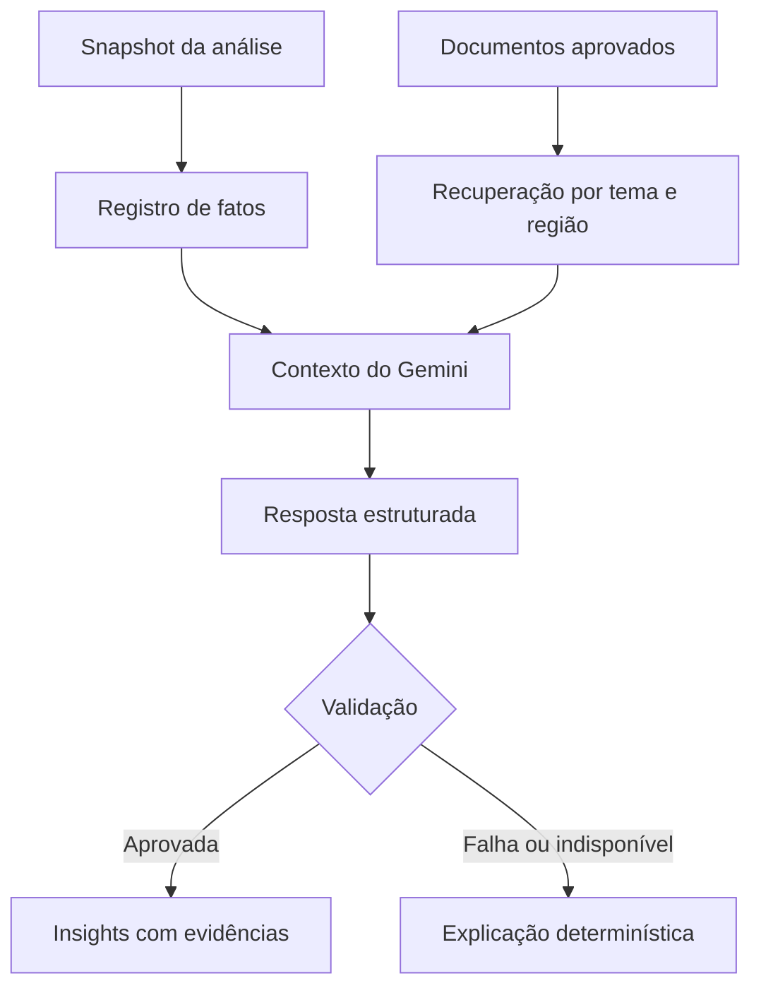

# Esboço — pipeline de insights com Gemini e RAG

**Estado atualizado:** há implementação inicial de snapshots, HTTP de insights, recuperação lexical de trechos aprovados, adaptador Gemini opt-in e fallback. Veja [o contrato HTTP](../http-insights.md). Não há documentos agronômicos aprovados incluídos, crawler ou treinamento; chamadas reais ao Gemini não foram realizadas. O motor do sênior permanece responsável pelos cálculos e ranking. As seções abaixo também registram a arquitetura-alvo; o contrato HTTP descreve o que funciona nesta versão.

RAG é recuperação de referências para fornecer contexto na consulta. Não treina o Gemini nem altera os pesos do modelo. Fine-tuning seria outra etapa, com dados e avaliação próprios; não faz parte desta proposta.

## Resultado pretendido

Após `/v1/analysis`, apresentar poucas explicações úteis: o que foi observado, por que pode importar, quais alternativas já calculadas merecem revisão e o que perguntar ao produtor. Não prever produtividade, lucro ou sucesso da colheita.

| Entrada | Tratamento | Uso |
|---|---|---|
| POWER, relevo, vegetação, estresse, Earthdata | Preservar o snapshot, período, ponto, unidade, qualidade e resolução | Evidências numéricas atuais do caso |
| Resultado do motor | Extrair fatos com IDs e caminhos no JSON, incluindo limitações | Notas, alternativas, conflitos e lacunas calculados |
| Buscas por referências agronômicas | Obter documento completo, verificar autoria, contexto, versão, direitos de uso e aplicabilidade regional | Base de conhecimento RAG |
| Informações técnicas do produtor | Identificar origem, data, campos desconhecidos e permissão de uso | Contextualizar sem inventar informações |

Dados específicos da fazenda não precisam ir para um banco vetorial compartilhado. O primeiro MVP envia fatos estruturados de uma análise e recupera referências agronômicas separadamente.

## Dois fluxos independentes

### A. Preparar a base de conhecimento

1. Definir fontes candidatas: Embrapa, publicações oficiais NASA, FAO e documentos regionais aplicáveis. Autoridade do domínio não dispensa conferir o documento e a licença.
2. Buscar por cultura, região e tema. Resultado de busca é uma pista; o snippet não é evidência final.
3. Buscar o documento selecionado e guardar URL original, título, autoria, data, data de consulta e hash do conteúdo. Não seguir instruções contidas no texto recuperado.
4. Extrair texto e tabelas com página/seção preservadas. Tabelas agronômicas devem manter cabeçalhos, unidades e notas.
5. Revisar aplicabilidade: cultivar, clima, solo, região, edição e eventuais conflitos. Documentos vencidos, sem origem ou incompatíveis ficam fora do índice ativo.
6. Dividir por seção em trechos pequenos, mantendo referências à página e ao documento. Deduplicar pelo hash.
7. Indexar apenas trechos aprovados. MVP: SQLite FTS5 com busca lexical e filtros de metadados; embeddings e busca vetorial ficam para uma evolução avaliada.

Cada trecho precisa de `chunk_id`, `document_id`, título, URL, página/seção, texto, região, culturas, tema, versão, hash e estado de revisão. Documentos não se tornam regras do motor automaticamente.

### B. Explicar uma análise

1. Receber um `analysis_id` e carregar o snapshot autorizado do backend. Evitar aceitar resultados arbitrários enviados pelo navegador como evidência confiável.
2. Montar um registro de fatos com ID, caminho no snapshot, valor, unidade, período, origem e limitações. Descartar campos inválidos; ausência permanece ausência.
3. Gerar consultas RAG com culturas, temas e lacunas. Não incluir nome, coordenadas exatas ou dados pessoais quando desnecessários.
4. Recuperar e ordenar trechos compatíveis com região/cultura e versão, com limite de contexto e diversidade de fontes. Resultado irrelevante não deve ser usado só para preencher a cota.
5. Montar o prompt com três blocos distintos: instruções do sistema, fatos do caso e documentos de referência. Dados e documentos são conteúdo, não instruções.
6. Chamar o Gemini pelo backend, com chave em variável de ambiente, modelo configurável e resposta JSON estruturada.
7. Validar formato e fundamentação antes de exibir. Se falhar, usar explicações determinísticas já existentes; não substituir o resultado do motor por texto não validado.
8. Registrar modelo, versão do prompt, versão do motor, IDs/hashes das referências e hash do snapshot, sem registrar chaves de API.



## Validação: JSON correto não significa insight correto

- Conferir o schema e limitar quantidade/tamanho dos insights.
- Todo `fact_id` e `reference_id` precisa existir no contexto enviado. URLs devem ser resolvidas pelo backend, nunca aceitas como citações inventadas pelo modelo.
- Uma interpretação agronômica exige evidência do caso e referência compatível. Se não houver base suficiente, retornar lacuna e pergunta ao produtor.
- Números e unidades vêm do registro de fatos. A saída planejada usa IDs de fatos; o frontend recebe os valores hidratados pelo backend. Pedir texto sem novos números reduz erros, mas ainda requer verificação.
- Comparações precisam do mesmo período/base de referência ou de ressalva explícita. NDVI baixo não comprova solo descoberto; LST não é temperatura do ar; GRACE não descreve água disponível no talhão.
- Não autorizar Gemini a alterar notas, criar estratégias fora do conjunto calculado, afirmar causalidade, prometer ganhos ou definir dosagem de manejo sem método validado.
- Checar negações e contradições, não apenas igualdade dos números. Uma frase pode manter o número e inverter seu significado.
- Resultado de busca, PDF ou feedback do usuário não pode instruir o sistema a ignorar suas regras.
- Validação semântica automática é parcial. Insights novos de manejo requerem revisão local; feedback deve alimentar avaliação e revisão, não atualizar o catálogo sozinho.

## Contratos e artefatos deste esboço

- `system-prompt.txt`: instruções propostas para o gerador.
- `insights.schema.json`: contrato local da saída. O adaptador Gemini deverá conferir o subconjunto JSON Schema suportado pelo modelo escolhido.
- `example-context.json`: exemplo sintético, sem representar consulta NASA ou referência agronômica real.
- `example-output.json`: resposta ilustrativa com IDs válidos do exemplo, sem previsão ou recomendação inventada.

Futura resposta do serviço deve acrescentar um envelope:

```json
{
  "status": "validated_or_fallback",
  "analysis_id": "id-do-snapshot",
  "model": "modelo-configurado",
  "prompt_version": "geosafra-insights-v1",
  "knowledge_version": "versao-do-indice",
  "insights": [],
  "resolved_evidence": [],
  "validation_notes": []
}
```

Os campos de auditoria são criados pelo backend, não declarados pelo LLM. `status` terá valores separados `validated`, `fallback` e `insufficient_evidence`; o texto do exemplo acima é apenas um marcador descritivo.

## Integração futura com a geo-service1

| Componente proposto | Responsabilidade |
|---|---|
| `app/insights/snapshot.py` | Normalizar fatos dos contratos do sênior e vincular período/local |
| `app/insights/knowledge.py` | Ingestão revisada, metadados e recuperação FTS5 |
| `app/insights/gemini.py` | Adaptador da API, timeout, limite de saída e tratamento de cota |
| `app/insights/validator.py` | Schema, IDs, coerência e bloqueios semânticos básicos |
| `app/insights/service.py` | Orquestração, cache e fallback |
| `POST /v1/insights` | Carregar snapshot autorizado pelo ID; não executar dentro do request de análise |
| `POST /v1/feedback` | Registrar avaliação associada ao insight e versões, sem alterar regras automaticamente |

Nesta entrega existem `/v1/insights`, consulta de capacidades e snapshots por ID, com os componentes concentrados em `app/insights/`. Feedback, ingestão automatizada e validação semântica abrangente continuam pendentes. `/v1/analysis` preserva as notas e acrescenta metadados de snapshot; Gemini não é necessário para comparar rotações.

## Configuração e controle de consumo propostos

Variáveis futuras: `GEMINI_API_KEY`, `GEMINI_MODEL`, `INSIGHTS_ENABLED=false`, `INSIGHTS_TIMEOUT_SECONDS`, `INSIGHTS_MAX_OUTPUT_TOKENS`, `INSIGHTS_MAX_CALLS_PER_ANALYSIS` e `RAG_INDEX_PATH`.

Começar com uma chamada por snapshot, até três insights e poucas referências relevantes. Cache por hash do snapshot + prompt + índice + modelo. Evitar repetição automática de respostas já validadas; limitar tentativas para erros transitórios. Cota esgotada, timeout ou chave ausente produzem fallback claro.

A camada gratuita e a disponibilidade dos modelos precisam ser conferidas na integração; não assumir que geração, embeddings, busca web e File Search são todos gratuitos. Por isso a primeira proposta recupera documentos localmente e envia o contexto selecionado à API. Não foi escolhido um ID fixo de modelo.

Antes de enviar dados reais, verificar retenção e uso de conteúdo no plano contratado. No MVP, preferir dados demonstrativos e contexto mínimo; nenhuma credencial Earthdata/GeoSafra deve entrar no prompt.

## Testes de aceitação a implementar

| Cenário | Resultado esperado |
|---|---|
| Solo não informado | Pergunta ao produtor; nenhum pH ou textura inventado |
| Documento de outra cultura/região | Não utilizado como fundamento específico do caso |
| Referência ou fato inexistente | Resposta rejeitada e fallback |
| Texto atribui dado regional ao talhão | Bloqueio ou revisão explícita |
| Documento contém instrução maliciosa | Conteúdo tratado como referência, sem obedecer à instrução |
| Gemini responde JSON inválido ou muda números/unidades | Rejeição; ranking original preservado |
| Chave ausente, timeout ou cota | Comparação continua funcionando sem IA |
| Mudança no snapshot ou documento | Cache anterior invalidado pela versão/hash |
| Fontes agronômicas discordam | Mostrar conflito e necessidade de revisão local |
| Caso sintético de ponta a ponta | IDs citados e evidências resolvidas batem com o snapshot |

Usar um pequeno conjunto revisado de casos para avaliar fundamentação, relevância, clareza, abstenção e fidelidade ao motor. Não medir qualidade apenas pela fluência do texto.

## Ordem de implementação

1. Registro de fatos e explicação determinística, com exemplos revisados.
2. Pequena base documental aprovada e recuperação local.
3. Gemini com schema e resposta validada, usando dados demonstrativos.
4. Testes negativos, limites de consumo e auditoria.
5. Exibição opcional de insights na bancada e revisão com produtor/técnico.

## Documentação oficial consultada

- [Gemini — respostas estruturadas](https://ai.google.dev/gemini-api/docs/structured-output)
- [Gemini — File Search / RAG](https://ai.google.dev/gemini-api/docs/file-search)

A API oferece suporte a respostas estruturadas e recuperação por arquivos. Esta proposta começa com recuperação local para controlar fontes e dependências; File Search pode ser avaliado depois.
